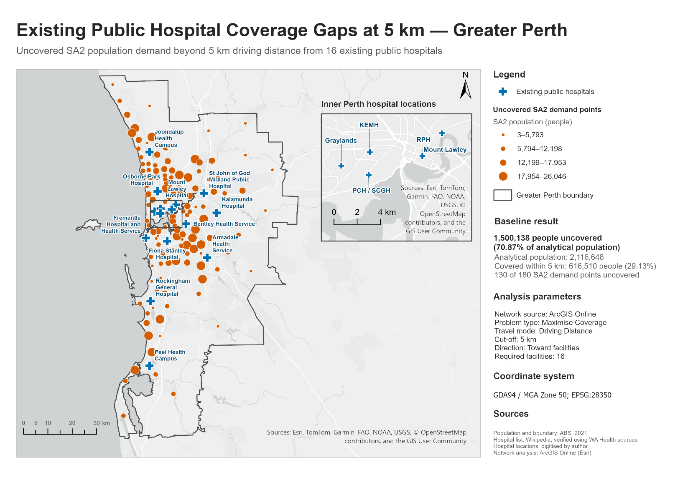
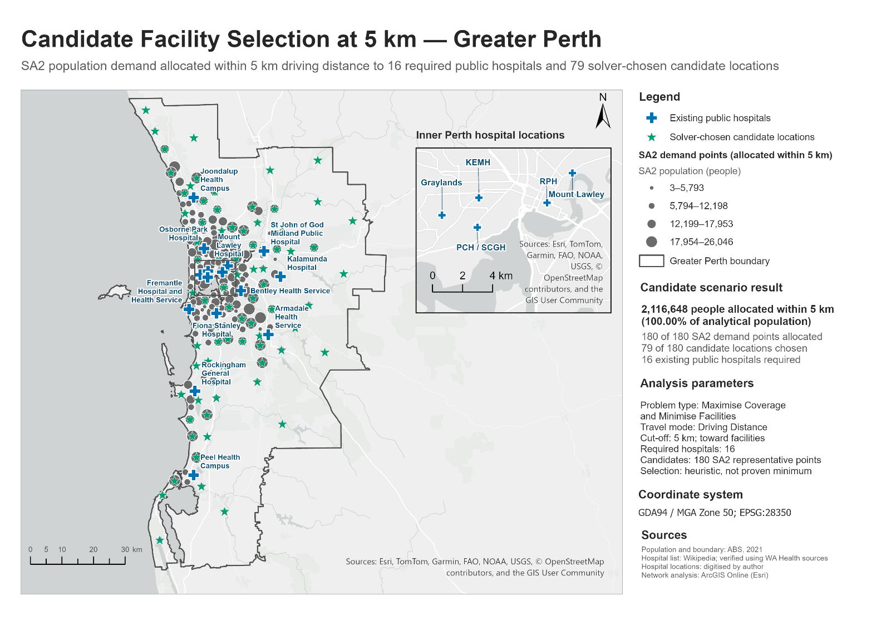
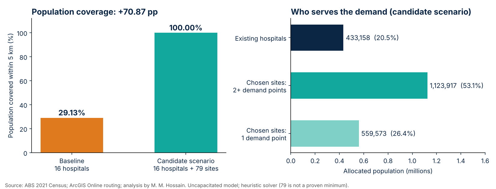
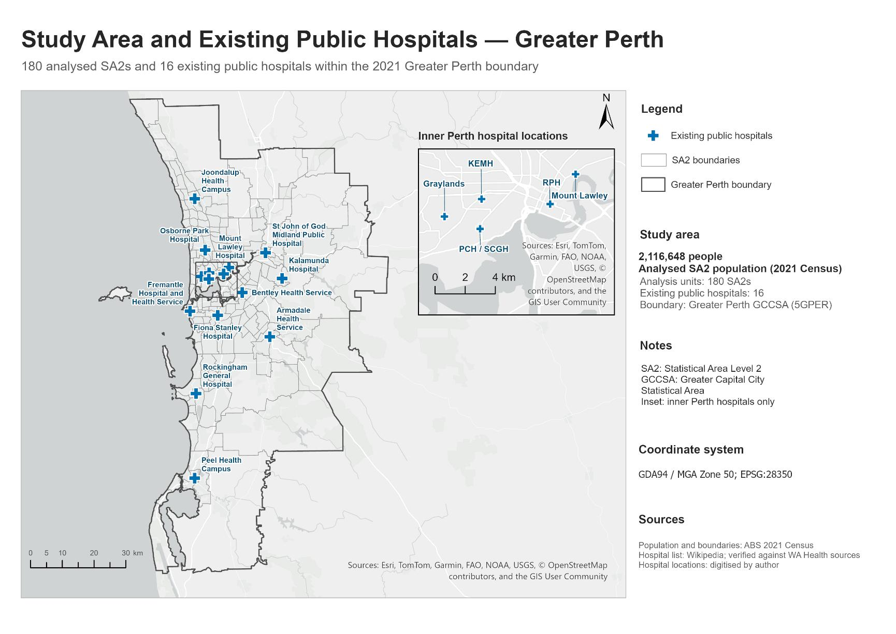

**GIS Portfolio Project — ArcGIS Pro, Network Analyst and Location-Allocation**
> **About this project:** completed as coursework for SPAT5008 Applied GIS at Curtin University (2026). Results describe modelled allocation of SA2 demand points along the road network. Candidate locations are analytical outputs, not assessed premises.

I combined Census population data, a hospital inventory checked against official sources and road-network location-allocation to assess existing coverage and identify additional analytical locations. Spatial data checks and comparative cartography supported interpretation of the results for preliminary testing-clinic planning.

## 🎯 The Question

How much of Greater Perth's analytical population is represented by SA2 demand points within 5 km driving distance of an existing public hospital, and where could additional analytical locations address the modelled gaps? The project frames this as a pandemic testing-clinic planning problem.

---

## 🗂️ Data and Setup

- **Demand:** 180 Statistical Area Level 2 (SA2) demand points from the ABS 2021 Census, each weighted by total persons. Together they represent an analytical population of **2,116,648**.
- **Facilities:** 16 operational, inpatient public hospitals inside Greater Perth. The 34 entries in Wikipedia's metropolitan hospital list were screened by type, and 19 were checked in detail against official sources.
- **Candidates:** 180 analytical candidate locations, one at every demand point.
- **Network:** ArcGIS Online road network, 5 km driving-distance cut-off.
- **Coordinate system:** GDA94 / MGA Zone 50.

---

## 🛠️ Method

1. **Prepared demand:** created one representative point per SA2 and checked multipart SA2s against imagery. The Fremantle point was moved off Rottnest Island (no road link) to the mainland.
2. **Built the hospital inventory:** digitised each of the 16 hospitals at its principal public vehicle entrance.
3. **Baseline model:** ran *Maximise Coverage* with all 16 hospitals as Required facilities.
4. **Candidate model:** ran *Maximise Coverage and Minimise Facilities* with the 16 hospitals plus the 180 candidates.
5. **Validated results:** checked allocated population three ways, checked baseline allocation-line distances against the 5 km cut-off, and reviewed network-location status after each solve.

---

## 📊 Key Results

| Measure | Baseline (16 hospitals) | With candidates (16 hospitals + 79 candidates) | Change |
| ------- | :---: | :---: | :---: |
| Population represented by allocated demand points (5 km) | 616,510 (29.13%) | 2,116,648 (100.00%) | +70.87 pp |
| Demand points allocated | 50 of 180 | 180 of 180 | +130 |
| Solution facilities | 16 | 95 | +79 |

- **Baseline:** 50 of 180 SA2 demand points were allocated to a hospital within 5 km, representing 29.13% of the analytical population.
- **Where the gaps are:** many of the larger unallocated demand points sit *between* hospitals, in the northern suburbs (Joondalup–Osborne Park corridor) and the south-east (Bentley–Fiona Stanley–Armadale), not only on the urban fringe.
- **Candidate scenario:** the solver chose 79 of the 180 candidates, and every demand point was allocated within 5 km. Full allocation was expected, because a candidate was placed at every demand point. The solver is heuristic, so 79 is not a proven minimum.
- **Allocation split:** demand points assigned to hospitals represented 433,158 people (20.46%); those assigned to chosen candidates represented 1,683,490 people (79.54%).
- **Multi-point candidates:** 27 chosen candidates were each allocated two or more demand points, representing 1,123,917 people (53.10%). They are a possible starting group for premises screening, not a priority ranking or shortlist.

---

## 🗺️ Maps and Charts

*Figure 1. Baseline: 130 of 180 SA2 demand points, representing 1,500,138 people (70.87%), were not allocated to an existing public hospital within 5 km driving distance.*

*Figure 2. With the 16 hospitals retained, the hospitals and 79 chosen candidates together allocated all 180 demand points within 5 km. Candidates are analytical locations, not assessed premises.*

*Figure 3. Comparison of the baseline and candidate scenarios.*

*Figure 4. Greater Perth GCCSA (5GPER): 180 analysed SA2s and 16 existing public hospitals.*

Select any map to open it at full size.

---

## ⚠️ Limitations

- **Representative points:** each SA2 is one point, so results describe modelled allocation, not each person's actual travel distance.
- **Driving only, no capacity:** walking, public transport, staffing and clinic throughput are not modelled.
- **Analytical candidates:** the 79 chosen candidates are optimisation outputs, not assessed premises.
- **Heuristic solver:** 79 is the solver's result for this candidate pool and these settings, not a proven minimum.
- **Hospital inventory:** facilities absent from Wikipedia's metropolitan list (for example, Murray District Hospital) were not added.
- **Network consistency and reproducibility:** the network data version was not recorded, and network-location flags differed between solves. Network consistency between scenarios remains unverified, and exact reproducibility cannot be guaranteed.
- **Temporal mismatch:** 2021 population is compared with September 2026 hospital status.

---

## 🧰 Tools and Skills

| Category | Detail |
| -------- | ------ |
| GIS | ArcGIS Pro 3.7, Network Analyst location-allocation (Maximise Coverage; Maximise Coverage and Minimise Facilities) |
| Data preparation | ABS Census GeoPackages, projection to MGA Zone 50, Feature To Point, Multipart To Singlepart, Select By Location |
| Skills | Spatial optimisation (Maximal Covering Location Problem, set covering), network-based accessibility analysis, data validation, cartography, and clear reporting of limitations |

---

## 📂 Project Resources

- **GitHub Repository:** [README, maps, results tables and methodology](https://github.com/moshraf/perth-hospital-coverage-location-allocation)
- **Full report (PDF):** [Read the 26-page report](https://github.com/moshraf/perth-hospital-coverage-location-allocation/blob/main/report/Perth_Hospital_Coverage_Location_Allocation_Report.pdf)

**Data and attribution:** ABS 2021 Census GeoPackages and ASGS Edition 3 boundaries; Esri ArcGIS Online routing service and basemaps © Esri and its data partners. Raw source data is not redistributed. © 2026 Moshraf Hossain. Report, maps and figures are my original work.

---

## 📧 Let's Connect

- Portfolio: <https://moshraf.github.io/>
- GitHub: <https://github.com/moshraf>
- LinkedIn: <https://linkedin.com/in/moshrafhossain>
